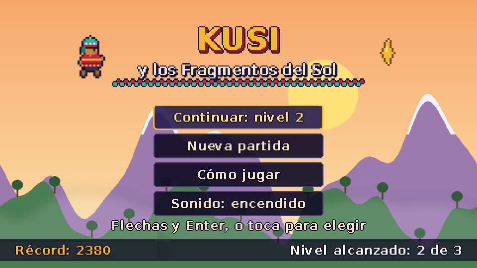
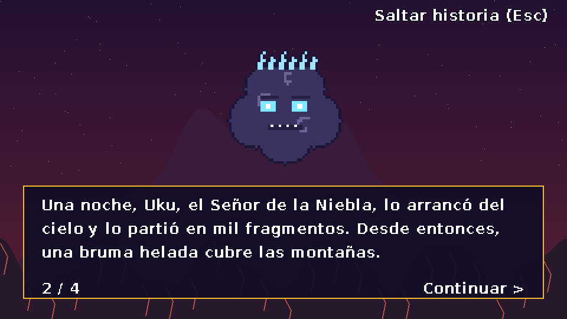
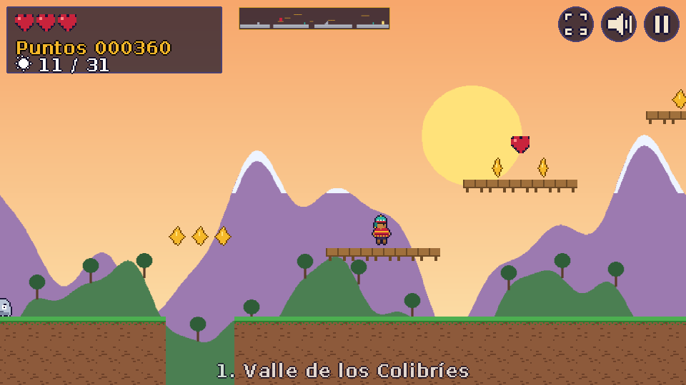
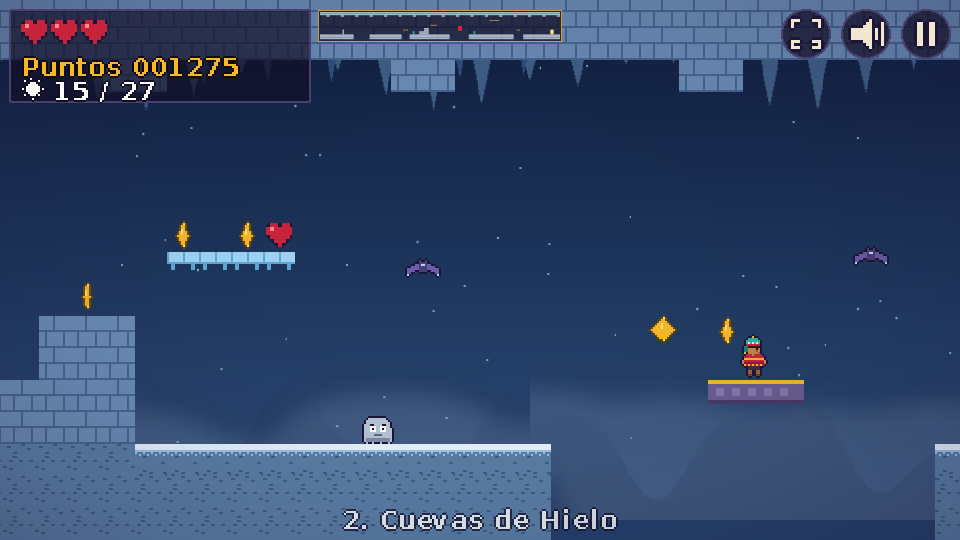
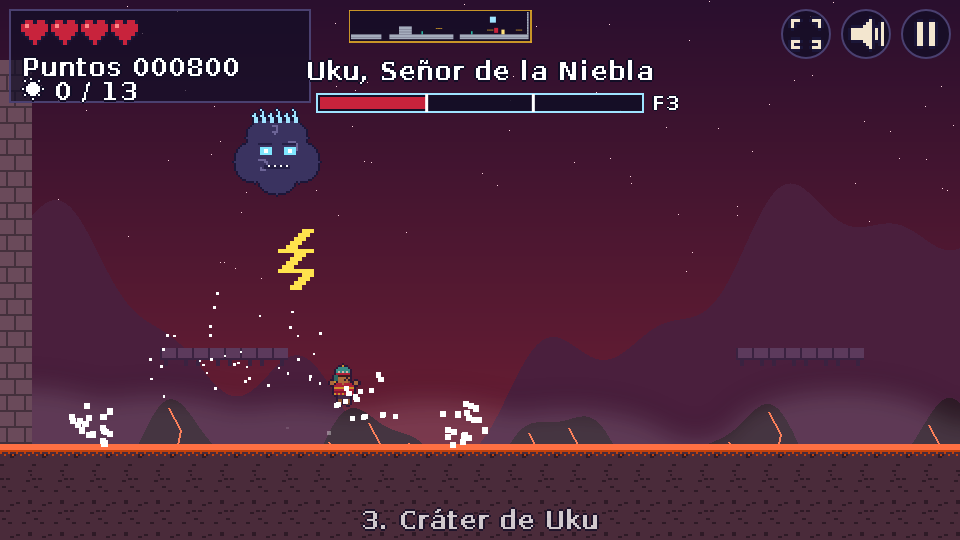
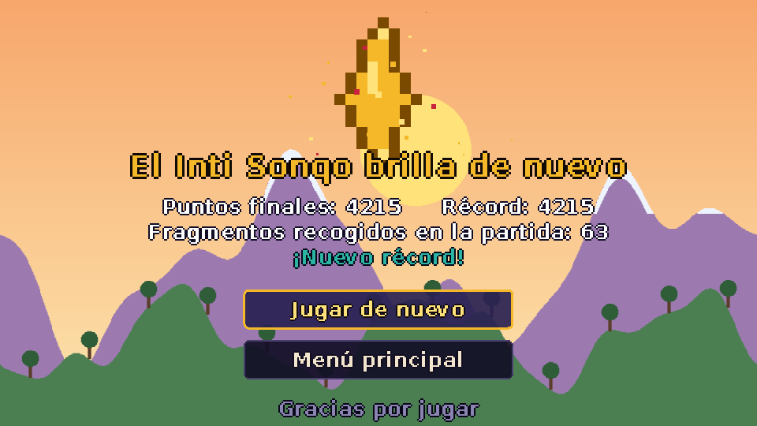

# Kusi y los Fragmentos del Sol

Videojuego de plataformas 2D hecho con **Phaser 3.90** y **Vite 7** para el Proyecto Final de Primer Bimestre de Aplicaciones Web (Escuela Politécnica Nacional).

**Arquetipo elegido:** Plataforma 2D (saltos, plataformas, scroll lateral, checkpoints y enemigos).

## Historia

Uku, el Señor de la Niebla, arrancó del cielo el *Inti Sonqo* (Corazón del Sol) y lo partió en fragmentos. Desde entonces una bruma helada cubre los Andes. Kusi, la chasqui más veloz de su pueblo, recorre tres caminos para recuperar los fragmentos:

1. **Valle de los Colibríes**: aprendizaje de saltos, resortes y enemigos.
2. **Cuevas de Hielo**: suelo resbaloso, losas móviles sobre el abismo y púas.
3. **Cráter de Uku**: camino final y pelea contra el jefe.

La historia se cuenta con escenas narradas (introducción, dos interludios y epílogo) con texto que se escribe letra a letra.

## Capturas

| Menú principal | Historia |
| --- | --- |
|  |  |
| **Nivel 1: Valle de los Colibríes** | **Nivel 2: Cuevas de Hielo** |
|  |  |
| **Nivel 3: jefe final Uku** | **Victoria** |
|  |  |

## Requisitos

- Node.js 20.19+ o 22.12+ (exigido por Vite 7)
- npm 10 o superior
- Navegador actualizado (Chrome, Edge, Firefox o Safari)

## Instalación y ejecución

```bash
npm install        # instala phaser y vite
npm run dev        # servidor de desarrollo en http://localhost:5173
npm run build      # versión de producción en la carpeta dist/
npm run preview    # sirve dist/ en http://localhost:4173
```

La carpeta `dist/` se puede publicar en cualquier servidor estático (GitHub Pages, Netlify, etc.): las rutas son relativas.

## Controles

| Acción | Teclado | Pantalla táctil |
| --- | --- | --- |
| Moverse | Flechas ← → o A / D | Botones ◀ ▶ abajo a la izquierda |
| Saltar (mantener = salto más alto) | Espacio, W, Z o Flecha arriba | Botón ▲ abajo a la derecha |
| Dash (uno por salto) | Shift o X | Botón ≫ junto al de saltar |
| Pausa | P o Esc | Icono de pausa (arriba a la derecha) |
| Silenciar | M | Icono de sonido |
| Pantalla completa | — | Icono de pantalla completa |
| Navegar menús | Flechas + Enter | Tocar el botón |

Los controles táctiles aparecen solos en dispositivos táctiles y admiten varios dedos (correr, saltar y hacer dash a la vez). En móviles en vertical se pide girar el dispositivo.

## Cómo se juega

- Recoge **fragmentos de sol** (+10 puntos) y **corazones** (una vida más, máximo 5).
- Salta sobre **Neblinos** y **murciélagos de escarcha** para derrotarlos (+50). Tocarlos de lado quita una vida.
- Las **púas de hielo** dañan; caer a un **pozo** quita una vida y te devuelve a la última **apacheta** encendida (punto de control).
- La **flor de puya** funciona como resorte.
- Llega a la **Puerta del Sol** para terminar el nivel. Ganas un bono por tiempo y por vidas restantes.
- **Uku** es invulnerable en el aire: esquiva sus esquirlas de hielo, espera a que se lance en picada y salta sobre él mientras está aturdido. Tiene 6 puntos de vida y a la mitad se vuelve más agresivo.
- **Victoria:** derrotar a Uku y entrar en la Puerta del Sol. **Derrota:** quedarse sin vidas.

## Estructura del proyecto

```
kusi-fragmentos-del-sol/
├── index.html                 # contenedor del juego y aviso de orientación
├── vite.config.js             # rutas relativas y separación de Phaser en su propio archivo
├── public/
│   ├── assets/images|audio|fonts   # recursos originales generados por tools/
│   ├── manifest.webmanifest   # PWA
│   ├── sw.js                  # service worker (juego sin conexión)
│   └── icons/
├── src/
│   ├── main.js                # configuración de Phaser
│   ├── config/constants.js    # física, puntos, colores, eventos
│   ├── data/                  # niveles en ASCII e historia
│   ├── assets/assetManifest.js
│   ├── audio/audioKeys.js
│   ├── scenes/                # Boot, Preload, Menu, Help, Story, Game, UI, Pause, GameOver, Victory
│   ├── objects/               # Player, Enemy, Neblino, Murcielago, Uku, IceShard, Collectible...
│   ├── physics/               # LevelBuilder (tilemap) y CollisionSystem (colliders, overlaps, triggers)
│   ├── managers/              # EventBus, StateMachine, GameState, Storage, Audio, Input, Session...
│   └── ui/                    # TextButton, MenuList, HUD (Minimap, BossBar, TouchControls), paralaje
├── tools/                     # scripts que generan imágenes y audio
├── tests/                     # pruebas funcionales automatizadas (Playwright)
└── docs/                      # capturas, guía técnica, autoevaluación y guion del video
```

La explicación detallada de la arquitectura está en [docs/GUIA_TECNICA.md](docs/GUIA_TECNICA.md).

## Requisitos del enunciado y dónde se cumplen

| Requisito | Implementación |
| --- | --- |
| Escenas, loader, estados | 11 escenas; `PreloadScene` con barra de progreso; `GameStateManager` y `StateMachine` |
| Menú, pausa, Game Over, reinicio | `MenuScene`, `PauseScene` (continuar, reiniciar, salir), `GameOverScene` (reintentar) |
| Movimiento, colisiones, puntaje, HUD | `Player`, `CollisionSystem`, `GameSession`, `UIScene` |
| Enemigos, victoria y derrota | Neblino, murciélago, púas, jefe Uku; Puerta del Sol; sin vidas = Game Over |
| Arcade Physics, overlaps, triggers, gravedad y rebotes | Gravedad global, tilemap con colisiones de un solo sentido, overlaps de objetos, triggers (apachetas, arena del jefe, meta), resortes y pisotones |
| Audio | 3 músicas en bucle, 2 jingles y 14 efectos; botón y tecla M para silenciar |
| Persistencia (localStorage) | Récord, nivel alcanzado (desbloquea niveles en "Elegir nivel"), partida para "Continuar", silencio y modo de gráficos |
| Responsive y táctil | `Scale.FIT` 960×540, controles táctiles multitáctiles, pantalla completa |
| Rendimiento | Object pooling, minimapa precalculado, capas de fondo recortadas, calidad adaptativa por debajo de 45 FPS |
| Accesibilidad | Paleta de alto contraste con contorno en el texto, instrucciones en "Cómo jugar", foco visible con teclado, mute |
| Bonus | Jefe final, minimapa, PWA instalable, efectos de shader (viñeta y brillo en WebGL) |

## Parámetros de URL útiles

| Parámetro | Efecto |
| --- | --- |
| `?fps` | Muestra el contador de FPS desde el inicio |
| `?debug` | Dibuja los cuerpos físicos de Arcade |
| `?tactil` | Muestra los controles táctiles en escritorio |
| `?canvas` | Fuerza el renderizador Canvas (equipos sin GPU) |
| `?ligero` | Desactiva niebla y shaders |

## Rendimiento

- En modo Canvas el juego completo se mantuvo en **60 FPS** en un navegador Chromium sin aceleración gráfica.
- Con WebGL hace falta una GPU real; en la máquina de prueba (sin GPU) no fue posible medirlo de forma representativa.
- Si durante el juego el promedio baja de 45 FPS, el juego activa solo el *modo de rendimiento*. Ese modo quita la niebla y los shaders, y la preferencia queda guardada.
- Para comprobarlo en tu equipo abre `http://localhost:5173/?fps`.

## Regenerar los recursos

Las imágenes, la fuente pixelada y el audio son originales y se generan con scripts (requieren Python 3, Pillow, NumPy y ffmpeg):

```bash
npm run assets
```

## Pruebas automatizadas

`tests/pruebas_funcionales.py` recorre el juego en un navegador real y verifica 22 casos. Entre ellos están el movimiento, el salto, los pisotones, el daño, los resortes, los checkpoints, la pausa, el silencio persistente, las losas móviles, el suelo de hielo, el Game Over, el jefe completo, la victoria y "Continuar". Requiere `pip install playwright` y el servidor de desarrollo en marcha.

## Créditos

- Programación, diseño de niveles, historia, sprites, fondos y música: autor del proyecto. Todos los recursos se generan con los scripts de `tools/`; no se usaron assets descargados.
- Motor: [Phaser 3](https://phaser.io) (licencia MIT). Herramienta de compilación: [Vite](https://vite.dev) (licencia MIT).
- Tipografía pixelada derivada de DejaVu Sans Bold (licencia libre de Bitstream Vera / DejaVu).
- Vocabulario quechua: *Inti* (sol), *sonqo* (corazón), *chasqui* (mensajero), *apacheta* (montículo de piedras de los caminos andinos), *chullo* (gorro andino).
